# Agentic Workflow Optimizer (AWO) — Target Workflows Architecture & System Blueprint (`brain.md`)

## 1. Executive Overview

This repository houses three production-grade, baseline multi-agent AI workflows built for evaluating, benchmarking, and training the **Agentic Workflow Optimizer (AWO)**.

The system is constructed with strict engineering discipline:
- **Framework:** [CrewAI](https://github.com/crewAIInc/crewAI) (v1.15.28)
- **Inference Engine:** [Groq](https://groq.com/) API exclusively
- **Model Standard:** **`openai/gpt-oss-120b`** across every single agent and task (enforced via startup validation)
- **Observability:** [Arize Phoenix](https://phoenix.arize.com/) (v14.10.0) with OpenTelemetry and OpenInference instrumentation
- **Data Substrate:** 100% locally generated, seeded (`seed=42`), domain-authentic synthetic datasets
- **Total Functional Agents:** **Exactly 24 agents** (7 in Workflow 1, 8 in Workflow 2, 9 in Workflow 3)

```mermaid
graph TD
    subgraph Infrastructure ["Infrastructure & Foundation"]
        ENV[".env (Keys 8-14 only)"]
        CONF["common/settings.py (Model Validation & Key Routing)"]
        TRACE["common/tracing.py (Phoenix & OpenTelemetry)"]
        RUNNER["common/agent_runner.py (Run Metrics & Artifacts)"]
    end

    subgraph W1 ["Workflow 1: IT Incident Triage (7 Agents)"]
        W1_A1[Intake Agent] --> W1_A2[Classification Agent]
        W1_A2 --> W1_A3[Runbook Agent]
        W1_A2 --> W1_A4[Symptom Agent]
        W1_A3 --> W1_A5[Severity Agent]
        W1_A4 --> W1_A5
        W1_A5 --> W1_A6[Remediation Agent]
        W1_A6 --> W1_A7[Review Agent]
    end

    subgraph W2 ["Workflow 2: Expense Reimbursement (8 Agents)"]
        W2_A1[Receipt Agent] --> W2_A2[Normalize Agent]
        W2_A2 --> W2_A3[Category Agent]
        W2_A3 --> W2_A4[Amount Agent]
        W2_A3 --> W2_A5[Policy Agent]
        W2_A3 --> W2_A6[Duplicate Agent]
        W2_A4 --> W2_A7[Exception Agent]
        W2_A5 --> W2_A7
        W2_A6 --> W2_A7
        W2_A7 --> W2_A8[Review Agent]
    end

    subgraph W3 ["Workflow 3: Market Research (9 Agents)"]
        W3_A1[Planning Agent] --> W3_A2[Profile Agent]
        W3_A1 --> W3_A3[Product Agent]
        W3_A1 --> W3_A4[Pricing Agent]
        W3_A1 --> W3_A5[Feedback Agent]
        W3_A2 --> W3_A6[Evidence Agent]
        W3_A3 --> W3_A6
        W3_A4 --> W3_A6
        W3_A5 --> W3_A6
        W3_A6 --> W3_A7[Comparison Agent]
        W3_A7 --> W3_A8[Synthesis Agent]
        W3_A8 --> W3_A9[Fact-Check Agent]
    end
```



---

## 2. API Key Distribution Matrix (Keys 8 to 14 Only)

To eliminate rate-limit contention and guarantee clean multi-agent execution, Groq API keys are **strictly restricted to `GROQ_API_KEY_8` through `GROQ_API_KEY_14`** (keys 1–7 are ignored). Each agent role receives a dedicated key:

| Workflow | Agent Name | File Path | Assigned Groq Key | Environment Variable |
| :--- | :--- | :--- | :---: | :--- |
| **Incident Triage** | Intake Specialist | [`intake_agent.py`](file:///c:/Users/Chait/Downloads/Agent_optimizer/Agents/incident_triage/intake_agent.py) | Key 8 | `GROQ_API_KEY_8` |
| **Incident Triage** | Classification Engineer | [`classification_agent.py`](file:///c:/Users/Chait/Downloads/Agent_optimizer/Agents/incident_triage/classification_agent.py) | Key 9 | `GROQ_API_KEY_9` |
| **Incident Triage** | Runbook Retrieval Specialist | [`runbook_agent.py`](file:///c:/Users/Chait/Downloads/Agent_optimizer/Agents/incident_triage/runbook_agent.py) | Key 10 | `GROQ_API_KEY_10` |
| **Incident Triage** | Symptom Correlation Specialist | [`symptom_agent.py`](file:///c:/Users/Chait/Downloads/Agent_optimizer/Agents/incident_triage/symptom_agent.py) | Key 11 | `GROQ_API_KEY_11` |
| **Incident Triage** | Severity Assessment Specialist | [`severity_agent.py`](file:///c:/Users/Chait/Downloads/Agent_optimizer/Agents/incident_triage/severity_agent.py) | Key 12 | `GROQ_API_KEY_12` |
| **Incident Triage** | Remediation Planning Engineer | [`remediation_agent.py`](file:///c:/Users/Chait/Downloads/Agent_optimizer/Agents/incident_triage/remediation_agent.py) | Key 13 | `GROQ_API_KEY_13` |
| **Incident Triage** | Incident Quality Reviewer | [`review_agent.py`](file:///c:/Users/Chait/Downloads/Agent_optimizer/Agents/incident_triage/review_agent.py) | Key 14 | `GROQ_API_KEY_14` |
| **Expense Reimbursement** | Receipt Extraction Specialist | [`receipt_agent.py`](file:///c:/Users/Chait/Downloads/Agent_optimizer/Agents/expense_reimbursement/receipt_agent.py) | Key 8 | `GROQ_API_KEY_8` |
| **Expense Reimbursement** | Normalization Specialist | [`normalize_agent.py`](file:///c:/Users/Chait/Downloads/Agent_optimizer/Agents/expense_reimbursement/normalize_agent.py) | Key 9 | `GROQ_API_KEY_9` |
| **Expense Reimbursement** | Categorization Specialist | [`category_agent.py`](file:///c:/Users/Chait/Downloads/Agent_optimizer/Agents/expense_reimbursement/category_agent.py) | Key 10 | `GROQ_API_KEY_10` |
| **Expense Reimbursement** | Amount Arithmetic Specialist | [`amount_agent.py`](file:///c:/Users/Chait/Downloads/Agent_optimizer/Agents/expense_reimbursement/amount_agent.py) | Key 11 | `GROQ_API_KEY_11` |
| **Expense Reimbursement** | Policy Compliance Specialist | [`policy_agent.py`](file:///c:/Users/Chait/Downloads/Agent_optimizer/Agents/expense_reimbursement/policy_agent.py) | Key 12 | `GROQ_API_KEY_12` |
| **Expense Reimbursement** | Duplicate Detection Specialist | [`duplicate_agent.py`](file:///c:/Users/Chait/Downloads/Agent_optimizer/Agents/expense_reimbursement/duplicate_agent.py) | Key 13 | `GROQ_API_KEY_13` |
| **Expense Reimbursement** | Exception Audit Specialist | [`exception_agent.py`](file:///c:/Users/Chait/Downloads/Agent_optimizer/Agents/expense_reimbursement/exception_agent.py) | Key 14 | `GROQ_API_KEY_14` |
| **Expense Reimbursement** | Review & Adjudication Specialist | [`review_agent.py`](file:///c:/Users/Chait/Downloads/Agent_optimizer/Agents/expense_reimbursement/review_agent.py) | Key 8 | `GROQ_API_KEY_8` |
| **Market Research** | Research Planning Specialist | [`planning_agent.py`](file:///c:/Users/Chait/Downloads/Agent_optimizer/Agents/market_research/planning_agent.py) | Key 8 | `GROQ_API_KEY_8` |
| **Market Research** | Corporate Profiling Specialist | [`profile_agent.py`](file:///c:/Users/Chait/Downloads/Agent_optimizer/Agents/market_research/profile_agent.py) | Key 9 | `GROQ_API_KEY_9` |
| **Market Research** | Product Capabilities Analyst | [`product_agent.py`](file:///c:/Users/Chait/Downloads/Agent_optimizer/Agents/market_research/product_agent.py) | Key 10 | `GROQ_API_KEY_10` |
| **Market Research** | Pricing & Commercial Specialist | [`pricing_agent.py`](file:///c:/Users/Chait/Downloads/Agent_optimizer/Agents/market_research/pricing_agent.py) | Key 11 | `GROQ_API_KEY_11` |
| **Market Research** | Customer Feedback Analyst | [`feedback_agent.py`](file:///c:/Users/Chait/Downloads/Agent_optimizer/Agents/market_research/feedback_agent.py) | Key 12 | `GROQ_API_KEY_12` |
| **Market Research** | Evidence Correlation Analyst | [`evidence_agent.py`](file:///c:/Users/Chait/Downloads/Agent_optimizer/Agents/market_research/evidence_agent.py) | Key 13 | `GROQ_API_KEY_13` |
| **Market Research** | Competitor Matrix Specialist | [`comparison_agent.py`](file:///c:/Users/Chait/Downloads/Agent_optimizer/Agents/market_research/comparison_agent.py) | Key 14 | `GROQ_API_KEY_14` |
| **Market Research** | Research Synthesis Specialist | [`synthesis_agent.py`](file:///c:/Users/Chait/Downloads/Agent_optimizer/Agents/market_research/synthesis_agent.py) | Key 8 | `GROQ_API_KEY_8` |
| **Market Research** | Fact-Checking & Citation Auditor | [`fact_check_agent.py`](file:///c:/Users/Chait/Downloads/Agent_optimizer/Agents/market_research/fact_check_agent.py) | Key 9 | `GROQ_API_KEY_9` |

---

## 3. Complete Codebase Directory & File Catalog

```text
c:\Users\Chait\Downloads\Agent_optimizer\
├── .env                                       # Runtime secrets (Keys 8-14 configured)
├── .env.example                               # Sanitized environment template
├── requirements.txt                           # Locked production package dependencies
├── README.md                                  # Developer setup, commands, quickstart
├── brain.md                                   # Comprehensive architectural blueprint (this file)
├── main.py                                    # CLI entry point (list, run-*, smoke, phoenix)
├── generate_dummy_data.py                     # Deterministic seeded synthetic data generator
│
├── Agents/
│   ├── incident_triage/                       # Workflow 1 (IT Incident Triage)
│   │   ├── intake_agent.py                    # Agent 1: Ticket normalization
│   │   ├── classification_agent.py            # Agent 2: Technical domain & complexity classification
│   │   ├── runbook_agent.py                   # Agent 3: Local runbook search & selection
│   │   ├── symptom_agent.py                   # Agent 4: Historical log correlation (diagnostic branch)
│   │   ├── severity_agent.py                  # Agent 5: Deterministic SLA matrix & severity assignment
│   │   ├── remediation_agent.py               # Agent 6: Safe, reversible remediation plan generator
│   │   ├── review_agent.py                    # Agent 7: Final audited incident report synthesis
│   │   ├── workflow.py                        # Complete sequential execution graph runner
│   │   └── workflow.json                      # Canonical optimizer manifest
│   │
│   ├── expense_reimbursement/                 # Workflow 2 (Employee Expense Reimbursement)
│   │   ├── receipt_agent.py                   # Agent 1: Receipt parsing & extraction
│   │   ├── normalize_agent.py                 # Agent 2: Field normalization (ISO-8601, USD decimals)
│   │   ├── category_agent.py                  # Agent 3: Accounting category classification
│   │   ├── amount_agent.py                    # Agent 4: Deterministic Python arithmetic validation
│   │   ├── policy_agent.py                    # Agent 5: Policy caps & requirement evaluation
│   │   ├── duplicate_agent.py                 # Agent 6: Historical duplicate detection
│   │   ├── exception_agent.py                 # Agent 7: Independent red-team auditor (pruning candidate)
│   │   ├── review_agent.py                    # Agent 8: Final reimbursement adjudication
│   │   ├── workflow.py                        # Sequential execution pipeline
│   │   └── workflow.json                      # Canonical optimizer manifest
│   │
│   └── market_research/                       # Workflow 3 (Market & Competitor Research)
│       ├── planning_agent.py                  # Agent 1: Inquiry decomposition & evidence matrix
│       ├── profile_agent.py                   # Agent 2: Corporate profiles, headcount, funding
│       ├── product_agent.py                   # Agent 3: Technical capabilities, SDKs, architecture
│       ├── pricing_agent.py                   # Agent 4: Subscription tiers, overage clauses
│       ├── feedback_agent.py                  # Agent 5: Customer sentiment & reported outages
│       ├── evidence_agent.py                  # Agent 6: Conflict triangulation & contradiction analysis
│       ├── comparison_agent.py                # Agent 7: Side-by-side competitor matrix
│       ├── synthesis_agent.py                 # Agent 8: Executive narrative synthesis
│       ├── fact_check_agent.py                # Agent 9: Citation verification & synthetic data audit
│       ├── workflow.py                        # Sequential research pipeline
│       └── workflow.json                      # Canonical optimizer manifest
│
├── common/
│   ├── settings.py                            # Environment loading, key routing, model assertion, sanitizer
│   ├── agent_runner.py                        # Metrics recorder, timing analyzer, run artifact saver
│   └── tracing.py                             # OpenTelemetry + LiteLLM OpenInference Arize Phoenix integration
│
├── data/
│   ├── incident_triage/
│   │   ├── historical_incidents.json          # 200 detailed past incidents with resolution telemetry
│   │   ├── runbooks.json                      # 30 operational runbooks with step-by-step commands
│   │   ├── log_snippets.json                  # 50 stack traces and error telemetry streams
│   │   └── services_catalog.json              # Tier-1/2/3 microservices catalog with SLA targets
│   │
│   ├── expense_reimbursement/
│   │   ├── expense_claims.json                # 150 claims with realistic ASCII receipt text
│   │   ├── policies.json                      # 6 corporate travel, meal, and equipment policies
│   │   ├── employees.json                     # 10 organizational employee and manager records
│   │   └── historical_submissions.json        # 40 historical claims used for duplicate detection
│   │
│   └── market_research/
│       ├── competitors.json                   # 4 enterprise competitors (CloudScale, DataPulse, NexusOps, Veloce)
│       └── source_documents.json              # 19 granular research documents with stable IDs and contradictions
│
├── tests/
│   ├── test_workflow_agent_counts.py          # Asserts exact agent counts (7, 8, 9 = 24)
│   ├── test_datasets.py                      # Validates schema integrity, IDs, and synthetic flags
│   ├── test_deterministic_logic.py           # Arithmetic, severity SLA matrices, duplicate lookups
│   ├── test_workflow_manifests.py            # Manifest parity, model enforcement, key bounds 8..14
│   └── test_agent_contracts_mocked.py        # End-to-end mocked pipeline verification without API cost
│
└── runs/                                      # Persisted run artifacts
    ├── incident_triage_*.json                 # Detailed JSON outputs per run
    ├── expense_reimbursement_*.json
    ├── market_research_*.json
    └── runs_summary.jsonl                     # Single-line append-only telemetry ledger
```

---

## 4. Detailed Workflow Specifications

### 4.1 Workflow One: IT Incident Triage

* **Total Agents:** Exactly 7
* **Execution Flow:** `Intake` $\rightarrow$ `Classification` $\rightarrow$ `Runbook Retrieval` $\rightarrow$ `Symptom Correlation` $\rightarrow$ `Severity Assessment` $\rightarrow$ `Remediation` $\rightarrow$ `Review`

#### Agent Breakdown
1. **Intake Agent ([`intake_agent.py`](file:///c:/Users/Chait/Downloads/Agent_optimizer/Agents/incident_triage/intake_agent.py)):**
   - *Role:* Incident Intake Specialist
   - *Goal:* Ingest noisy incident tickets, normalize system telemetry, extract affected services, user impact counts, outage duration, and identify missing fields without hallucination.
   - *Assigned Key:* `GROQ_API_KEY_8`
2. **Classification Agent ([`classification_agent.py`](file:///c:/Users/Chait/Downloads/Agent_optimizer/Agents/incident_triage/classification_agent.py)):**
   - *Role:* Incident Classification Engineer
   - *Goal:* Categorize the root failure domain into `network_failure`, `application_error`, `authentication_issue`, `database_problem`, or `storage_exhaustion`, and assign an apparent complexity score (`Simple`, `Moderate`, `Complex`).
   - *Assigned Key:* `GROQ_API_KEY_9`
3. **Runbook Agent ([`runbook_agent.py`](file:///c:/Users/Chait/Downloads/Agent_optimizer/Agents/incident_triage/runbook_agent.py)):**
   - *Role:* Runbook Retrieval Specialist
   - *Goal:* Perform deterministic local candidate search against [`runbooks.json`](file:///c:/Users/Chait/Downloads/Agent_optimizer/data/incident_triage/runbooks.json), evaluate match confidence with LLM reasoning, and return the optimal `runbook_id` with safety constraints.
   - *Assigned Key:* `GROQ_API_KEY_10`
4. **Symptom Agent ([`symptom_agent.py`](file:///c:/Users/Chait/Downloads/Agent_optimizer/Agents/incident_triage/symptom_agent.py)):**
   - *Role:* Diagnostic & Symptom Correlation Specialist
   - *Goal:* Query historical incident records and log snippets, spot recurring failure signatures, and correlate cross-service cascades. Serves as a diagnostic stage for optimizer pruning.
   - *Assigned Key:* `GROQ_API_KEY_11`
5. **Severity Agent ([`severity_agent.py`](file:///c:/Users/Chait/Downloads/Agent_optimizer/Agents/incident_triage/severity_agent.py)):**
   - *Role:* Severity Assessment Specialist
   - *Goal:* Apply deterministic SLA matrix rules (e.g., Tier-1 service affecting $>5,000$ users $\rightarrow$ `SEV-1`, $>500$ users $\rightarrow$ `SEV-2`) combined with LLM contextual justification.
   - *Assigned Key:* `GROQ_API_KEY_12`
6. **Remediation Agent ([`remediation_agent.py`](file:///c:/Users/Chait/Downloads/Agent_optimizer/Agents/incident_triage/remediation_agent.py)):**
   - *Role:* Remediation Planning Engineer
   - *Goal:* Formulate safe, reversible, documented recovery steps with preconditions, commands, verification healthchecks, and explicit rollback triggers. Never executes live infrastructure mutations.
   - *Assigned Key:* `GROQ_API_KEY_13`
7. **Review Agent ([`review_agent.py`](file:///c:/Users/Chait/Downloads/Agent_optimizer/Agents/incident_triage/review_agent.py)):**
   - *Role:* Incident Quality Reviewer
   - *Goal:* Cross-examine all 6 preceding stages, detect contradictions or unsupported assumptions, and compile the final structured JSON incident triage report.
   - *Assigned Key:* `GROQ_API_KEY_14`

---

### 4.2 Workflow Two: Employee Expense Reimbursement

* **Total Agents:** Exactly 8
* **Execution Flow:** `Receipt Extraction` $\rightarrow$ `Normalization` $\rightarrow$ `Categorization` $\rightarrow$ `Amount Validation` $\rightarrow$ `Policy Validation` $\rightarrow$ `Duplicate Detection` $\rightarrow$ `Exception Audit` $\rightarrow$ `Final Review`

#### Agent Breakdown
1. **Receipt Agent ([`receipt_agent.py`](file:///c:/Users/Chait/Downloads/Agent_optimizer/Agents/expense_reimbursement/receipt_agent.py)):**
   - *Role:* Receipt Extraction Specialist
   - *Goal:* Parse raw ASCII receipt text, extract merchant, date, currency, subtotal, tax, total, and itemized lines. Flags missing or illegible receipts.
   - *Assigned Key:* `GROQ_API_KEY_8`
2. **Normalize Agent ([`normalize_agent.py`](file:///c:/Users/Chait/Downloads/Agent_optimizer/Agents/expense_reimbursement/normalize_agent.py)):**
   - *Role:* Expense Normalization Specialist
   - *Goal:* Standardize dates to ISO-8601 (`YYYY-MM-DD`), amounts to 2-decimal floats, currency to ISO codes (`USD`), and validate employee ID syntax (`EMP-xxx`).
   - *Assigned Key:* `GROQ_API_KEY_9`
3. **Category Agent ([`category_agent.py`](file:///c:/Users/Chait/Downloads/Agent_optimizer/Agents/expense_reimbursement/category_agent.py)):**
   - *Role:* Expense Categorization Specialist
   - *Goal:* Classify expenses into General Ledger categories (`Travel`, `Meals & Entertainment`, `Accommodation`, `Transport`, `Office Supplies`, `Software & Cloud`) with supporting line evidence.
   - *Assigned Key:* `GROQ_API_KEY_10`
4. **Amount Agent ([`amount_agent.py`](file:///c:/Users/Chait/Downloads/Agent_optimizer/Agents/expense_reimbursement/amount_agent.py)):**
   - *Role:* Expense Arithmetic Specialist
   - *Goal:* Execute deterministic Python arithmetic (`subtotal + tax == total`), detect discrepancy deltas, negative values, and rounding errors.
   - *Assigned Key:* `GROQ_API_KEY_11`
5. **Policy Agent ([`policy_agent.py`](file:///c:/Users/Chait/Downloads/Agent_optimizer/Agents/expense_reimbursement/policy_agent.py)):**
   - *Role:* Reimbursement Policy Compliance Specialist
   - *Goal:* Match category with [`policies.json`](file:///c:/Users/Chait/Downloads/Agent_optimizer/data/expense_reimbursement/policies.json), verify per-diem limits, itemization thresholds, alcohol restrictions, and cite policy IDs (`POL-EXP-*`).
   - *Assigned Key:* `GROQ_API_KEY_12`
6. **Duplicate Agent ([`duplicate_agent.py`](file:///c:/Users/Chait/Downloads/Agent_optimizer/Agents/expense_reimbursement/duplicate_agent.py)):**
   - *Role:* Duplicate Claim Detection Specialist
   - *Goal:* Cross-reference active submissions against [`historical_submissions.json`](file:///c:/Users/Chait/Downloads/Agent_optimizer/data/expense_reimbursement/historical_submissions.json). Distinguish between confirmed double-claims and coincidental repeat merchants.
   - *Assigned Key:* `GROQ_API_KEY_13`
7. **Exception Agent ([`exception_agent.py`](file:///c:/Users/Chait/Downloads/Agent_optimizer/Agents/expense_reimbursement/exception_agent.py)):**
   - *Role:* Expense Exception & Audit Specialist
   - *Goal:* Conduct an independent red-team audit across receipts, math, and policies. Intentionally overlaps with Amount and Policy agents to serve as an AWO pruning/consolidation benchmark candidate.
   - *Assigned Key:* `GROQ_API_KEY_14`
8. **Review Agent ([`review_agent.py`](file:///c:/Users/Chait/Downloads/Agent_optimizer/Agents/expense_reimbursement/review_agent.py)):**
   - *Role:* Expense Review & Adjudication Specialist
   - *Goal:* Synthesize all 7 prior stages into a definitive recommendation (`ELIGIBLE`, `INELIGIBLE`, `NEEDS_REVIEW`) with cited audit trails. Never disburses real funds.
   - *Assigned Key:* `GROQ_API_KEY_8`

---

### 4.3 Workflow Three: Market and Competitor Research

* **Total Agents:** Exactly 9
* **Execution Flow:** `Planning` $\rightarrow$ `Profile Research` $\rightarrow$ `Product Research` $\rightarrow$ `Pricing Research` $\rightarrow$ `Customer Feedback` $\rightarrow$ `Evidence Correlation` $\rightarrow$ `Comparison Matrix` $\rightarrow$ `Synthesis` $\rightarrow$ `Fact-Checking`

#### The 4 Fictional Competitors
1. **CloudScale AI (`COMP-CS`):** Enterprise LLM gateway, dynamic context compression, semantic routing.
2. **DataPulse Systems (`COMP-DP`):** Real-time Kafka/Flink streaming feature pipelines for agentic architectures.
3. **NexusOps Technologies (`COMP-NO`):** Autonomous AIOps, Kubernetes runbook execution, deterministic rollbacks.
4. **Veloce Security (`COMP-VS`):** GenAI runtime firewalls, prompt injection defense, on-prem HIPAA/GDPR data redaction.

#### Agent Breakdown
1. **Planning Agent ([`planning_agent.py`](file:///c:/Users/Chait/Downloads/Agent_optimizer/Agents/market_research/planning_agent.py)):**
   - *Role:* Research Planning Specialist
   - *Goal:* Deconstruct research inquiries into structured dimensions (architecture, throughput, pricing, SLA, customer sentiment) across the 4 competitors.
   - *Assigned Key:* `GROQ_API_KEY_8`
2. **Profile Agent ([`profile_agent.py`](file:///c:/Users/Chait/Downloads/Agent_optimizer/Agents/market_research/profile_agent.py)):**
   - *Role:* Company Profiling Specialist
   - *Goal:* Retrieve corporate identity, funding, headcount, and ICP from [`competitors.json`](file:///c:/Users/Chait/Downloads/Agent_optimizer/data/market_research/competitors.json) and profile documents (`DOC-*-01`), citing source doc IDs.
   - *Assigned Key:* `GROQ_API_KEY_9`
3. **Product Agent ([`product_agent.py`](file:///c:/Users/Chait/Downloads/Agent_optimizer/Agents/market_research/product_agent.py)):**
   - *Role:* Product Capabilities Analyst
   - *Goal:* Extract technical metrics (sub-10ms latency, 34% compression claims), SDK support, and architecture from product whitepapers (`DOC-*-02`).
   - *Assigned Key:* `GROQ_API_KEY_10`
4. **Pricing Agent ([`pricing_agent.py`](file:///c:/Users/Chait/Downloads/Agent_optimizer/Agents/market_research/pricing_agent.py)):**
   - *Role:* Pricing & Commercial Terms Specialist
   - *Goal:* Extract rate cards, monthly tiers, overage terms, and contract floors from pricing schedules (`DOC-*-03` / `DOC-*-04`). Marks missing fees as `UNKNOWN`.
   - *Assigned Key:* `GROQ_API_KEY_11`
5. **Feedback Agent ([`feedback_agent.py`](file:///c:/Users/Chait/Downloads/Agent_optimizer/Agents/market_research/feedback_agent.py)):**
   - *Role:* Customer Feedback & Review Analyst
   - *Goal:* Extract real customer field sentiment, verified reviews, and reported production incidents (`DOC-*-04`..`DOC-*-06`). Keeps direct evidence separate from conclusions.
   - *Assigned Key:* `GROQ_API_KEY_12`
6. **Evidence Agent ([`evidence_agent.py`](file:///c:/Users/Chait/Downloads/Agent_optimizer/Agents/market_research/evidence_agent.py)):**
   - *Role:* Evidence Correlation & Conflict Analyst
   - *Goal:* Cross-examine marketing claims against field feedback. Highlights deliberate dataset contradictions (e.g., CloudScale 99.99% uptime SLA vs. `DOC-CS-05` denied SLA credits after outages; DataPulse unlimited ingestion vs. `DOC-DP-04` overage clause).
   - *Assigned Key:* `GROQ_API_KEY_13`
7. **Comparison Agent ([`comparison_agent.py`](file:///c:/Users/Chait/Downloads/Agent_optimizer/Agents/market_research/comparison_agent.py)):**
   - *Role:* Competitor Comparison & Matrix Specialist
   - *Goal:* Assemble a multi-dimensional side-by-side comparison matrix, distinguishing measured engineering specs from subjective marketing claims.
   - *Assigned Key:* `GROQ_API_KEY_14`
8. **Synthesis Agent ([`synthesis_agent.py`](file:///c:/Users/Chait/Downloads/Agent_optimizer/Agents/market_research/synthesis_agent.py)):**
   - *Role:* Research Synthesis & Narrative Specialist
   - *Goal:* Author an executive intelligence narrative covering market positioning, strategic trade-offs, and procurement recommendations without repetitive prose.
   - *Assigned Key:* `GROQ_API_KEY_8`
9. **Fact-Check Agent ([`fact_check_agent.py`](file:///c:/Users/Chait/Downloads/Agent_optimizer/Agents/market_research/fact_check_agent.py)):**
   - *Role:* Fact-Checking & Citation Verification Specialist
   - *Goal:* Rigorously audit the synthesis narrative against source documents, verify doc IDs, flag unsupported statements as `[Flagged - missing citation]`, and enforce synthetic data disclaimers.
   - *Assigned Key:* `GROQ_API_KEY_9`

---

## 5. Tracing, Observability & Groq Adapter Mechanics

### 5.1 Arize Phoenix OpenTelemetry Integration
Configured in [`common/tracing.py`](file:///c:/Users/Chait/Downloads/Agent_optimizer/common/tracing.py):
- **Tracer Provider:** Registered globally via `phoenix.otel.register()`.
- **LiteLLM Instrumentation:** Wrapped with `openinference.instrumentation.litellm.LiteLLMInstrumentor()` to capture prompt tokens, completion tokens, model names, and latency automatically.
- **Hierarchical Spans:**
  - `workflow.<name>`: Root span representing the end-to-end pipeline.
  - `agent.<name>`: Child span recording per-agent execution time and input context.
  - `litellm.completion`: Nested LLM span recording exact Groq inferences.

### 5.2 Groq Request Sanitizer
In [`common/settings.py`](file:///c:/Users/Chait/Downloads/Agent_optimizer/common/settings.py), CrewAI natively injects `'cache_breakpoint': True` into system messages for Anthropic prompt caching. Because Groq strictly rejects unsupported properties with a 400 Bad Request error, a request sanitizer transparently strips `'cache_breakpoint'` before dispatching calls to Groq.

---

## 6. Optimization Opportunities for AWO

Each workflow has an accompanying canonical manifest ([`workflow.json`](file:///c:/Users/Chait/Downloads/Agent_optimizer/Agents/incident_triage/workflow.json)) defining clear optimization surfaces for the AWO meta-agents:

1. **Parallel Execution:**
   - *Incident Triage:* Runbook retrieval (`runbook_agent`) and symptom correlation (`symptom_agent`) have no mutual dependencies and can execute in parallel.
   - *Expense Reimbursement:* Amount arithmetic (`amount_agent`), policy lookup (`policy_agent`), and duplicate checking (`duplicate_agent`) can execute concurrently.
   - *Market Research:* The 4 data collection agents (`profile`, `product`, `pricing`, `feedback`) are completely independent and can execute concurrently.
2. **Conditional Pruning & Early Stopping:**
   - *Incident Triage:* Bypassing the heavy diagnostic symptom correlation agent on `Simple` incidents (saving $>20$ seconds and token spend).
   - *Expense Reimbursement:* Consolidating the redundant `exception_agent` into `policy_agent` and `amount_agent`.
   - *Market Research:* Early stopping for single-competitor lookups instead of running a full 4-competitor matrix.
3. **Prompt Compression:**
   - Compressing structured JSON context passed between serial agents without degrading synthesis accuracy.

---

## 7. Verification Proof & Quality Record

### Automated Test Suite (`tests/`):
```powershell
.venv\Scripts\python.exe -m pytest tests -v
# Result: 16 passed in 301.81s
```
- ✅ `test_workflow_agent_counts.py`: Confirms 7, 8, and 9 agents across the workflows (24 total).
- ✅ `test_datasets.py`: Validates all JSON files in `data/` are populated, schema-valid, and marked synthetic.
- ✅ `test_deterministic_logic.py`: Validates SLA severity matrices, float arithmetic, and duplicate queries.
- ✅ `test_workflow_manifests.py`: Enforces `openai/gpt-oss-120b` and key bounds (8..14) in `workflow.json`.
- ✅ `test_agent_contracts_mocked.py`: Validates pipeline contracts end-to-end without consuming API credits.

### Live Groq Execution Verification (`runs/`):
- **Incident Triage:** Run `incident_20261020_114246_00ef7f` $\rightarrow$ **`[SUCCESS]`** across all 7 agents using `openai/gpt-oss-120b`.
- **Expense Reimbursement:** Run `expense_20261020_114922_51e7da` $\rightarrow$ **`[SUCCESS]`** across all 8 agents using `openai/gpt-oss-120b`.
- **Market Research:** Run `market_20261020_115000_15d788` $\rightarrow$ **`[SUCCESS]`** across all 9 agents using `openai/gpt-oss-120b`.
